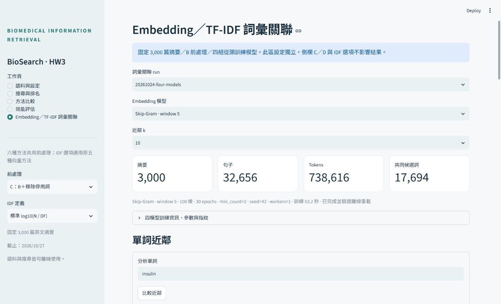

# 詞彙關聯交付與驗證紀錄

四組正式模型成功完成，無待完成訓練。主成果在 [獨立 run](../word_association/runs/20261024-four-models/manifest.json)，完整 [比較報告](../word_association/runs/20261024-four-models/REPORT.md) 保留十詞、45 詞對、四模型、Top-5／10／20 的全部結果；[方法與實際解釋](../../docs/WORD_ASSOCIATION.md) 回答窗口、架構、共現、頻率與單次 seed 限制。

## 實際規模與訓練

- 同一批 3,000 篇英文非空摘要；PMID 唯一、清單／順序、原始 XML、selection、JSONL 與 snapshot manifest SHA256 均已核對。
- 32,656 句、738,616 tokens、完整 B 詞彙 31,781。四模型各 17,694 詞，共同候選池 17,694。十個固定分析詞在五種空間全部有效。
- CBOW w2／w5、Skip-Gram w2／w5：各自新的 Word2Vec 初始化，100 維、30 epochs、min_count=2、seed=42、workers=1。共同參數與 HW2 四份實際 metadata 完全相同，見 [參考核對](hw2-reference.json)。未載入或續訓任何舊模型。
- 四模型各保存完整模型、原始向量、詞序／CF、30 epochs loss／時間、初始化與輸出 hash、語料／tokenizer／句界／程式指紋及版本。原始訓練 token 累計每模型 22,158,480（30 輪），與 metadata／模型 corpus_total_words 核對。
- 完成後以全新程序離線重載；每模型先重載驗證成功才標 complete，run 於四模型及報告完成後才標 complete。訓練執行紀錄：[training.log](training.log)。

## 主要結果

| 模型 | 平均 Top-10 重疊 | 45 詞對 Spearman |
|---|---:|---:|
| CBOW w2 | 3% | 0.1395 |
| CBOW w5 | 2% | 0.3029 |
| Skip-Gram w2 | 3% | 0.2966 |
| Skip-Gram w5 | 16% | 0.5316 |

本次一致程度有限，不能把一致度或 loss 當成語意正確率，也不能由單次 seed 宣稱架構普遍最佳。主報告保留全部結果及 CF／DF／共同文件數，沒有事後只保留符合預期案例。

## 測試與數值

- 變更前基準：**187 passed**，見 [baseline-pytest.xml](baseline-pytest.xml)。
- 最終完整測試：**216 passed**，見 [pytest-final.log](pytest-final.log)、[pytest-final.xml](pytest-final.xml)。包含既有搜尋、五權重、BM25、拼字、標註與評估，以及小型手算／IDF 抵消／詞欄向量／池與 ties／OOV／負分／Spearman／新程序模型重載／檔案損毀拒絕等測試；pytest 未訓練正式四模型。
- 修正跨頁表單還原後，新舊介面專項 **22 passed**，之後再次執行上方完整測試。見 [ui-final-pytest.log](ui-final-pytest.log)。
- 獨立重建全部 TF、CF、DF、IDF、文件 norm 與稀疏 TF-IDF；全部 45 詞對、每方法 15 個詞的 Top-20 以獨立 NumPy／SciPy 計算核對。最大矩陣誤差 **0**、詞對誤差 **9.99×10⁻¹⁶**、近鄰誤差 **3.33×10⁻¹⁶**；四模型離線重載、參數、詞頻與 hash 全部通過。見 [run validation.json](../word_association/runs/20261024-four-models/validation.json)。
- 執行既有 `scripts/verify_hw3.py` 的完整 main，透過既有包裝器將最終 JSON 另存，保留原 verification.json。B／C／D × 兩種 IDF 共核對 **900,000** 個 cosine（最大誤差 1.67×10⁻¹⁶）、**180,000** 個 BM25 分數（最大誤差 1.78×10⁻¹⁵），見 [numeric.json](numeric.json)。
- 最後只有新頁表單還原的 UI 變更，數學程式未改。最終程式來源指紋另存兩次新檢索 run，所有輸出與彼此、與上述數值驗證 run 均逐位元相同，見 [final-retrieval-runs.json](final-retrieval-runs.json)。
- pip check 通過；實際依賴鎖定於 HW3 requirements-lock.txt。模型 metadata 記錄 Python 3.12.14、Gensim 4.4.0、NumPy 2.5.4、SciPy 1.18.1 等版本。繪圖快取預設已移入 HW3/tmp；訓練時的原報告產生器仍完整凍結於 run/sources，不改寫舊來源指紋。

## 瀏覽器

實際操作 `http://127.0.0.1:8503`，確認四模型可切換、單詞近鄰、k=20、GLP‑1 正規化、兩詞比較、OOV／零返回、桌面並排熱圖、窄視窗、散點及模型圖例、CSV 下載。下載檔案有 45 列，SHA256 與 run/pairs.csv 完全一致，已移回本專案 [browser-downloaded-pairs.csv](browser-downloaded-pairs.csv)。

跨工作頁返回時，單詞與兩詞輸入框會還原最近提交值；已以實際瀏覽器與 AppTest 驗證。操作新頁不訓練，也不執行文件排名；介面測試以禁止呼叫 train／Engine.rank 的方式確認。新頁固定 B，不受檢索側欄 D／smooth 改變影響。

開發熱重載後曾遇到舊類別資源快取，已清除函式快取並以新連線重測搜尋及跨頁流程，最終無錯誤。未修改原拼字模組或模型。原拼字候選仍可將 `insulinn glucose` 明確採用為 `insulin glucose`；此後評估頁仍顯示 Q01 原查詢 `semaglutide weight loss obesity`。沒有儲存任何測試人工標註。

紀錄：[browser-observations.json](browser-observations.json)、[四模型可見狀態](browser-model-switches.json)。臨時桌面 viewport 已還原，完成頁面保留在瀏覽器。



## 隔離與檔案保留

- 變更前後 B／C／D × 標準／平滑 IDF × 十查詢 × 六方法，共 **360 組完整排名指紋完全相同**。人工、弱規則、PubMed 自動參考三來源的評估指紋也相同；現有人工來源沒有正例的狀態原樣保留，沒有冒充人工評估結果。
- `queries.json`、原人工標註、相關集合、原 1,000／現 3,000 篇快照與既有檢索結果均未回寫；評估使用原始查詢，沒有加入新的隱藏前處理。見 [baseline.json](baseline.json)、[isolation.json](isolation.json)。
- 最後重新核對 **1,604** 個保護檔案：HW2 **813** 個程式／資料／模型／報告等檔案，以及 HW3 原有資料／報告 **791** 個，SHA256 全部相同。HW2 虛擬環境與服務未操作；不把未逐檔雜湊的環境／暫存目錄冒稱為已做 hash 核對。見 [final-integrity.json](final-integrity.json)。
- Tier 2 圖證據：初始 HW3 generation `2026-10-19T02:24:17Z`，最終自動更新至 `2026-10-24T06:27:20Z`，相關程式 coverage metadata_match；PowerShell 的局部解析缺口已直接讀取。圖不是完整性保證，另以來源、測試與數值驗證補足。見 [graph-evidence.json](graph-evidence.json)、[graph-final.json](graph-final.json)。

## 重現

```powershell
# 新 run：四組都從頭訓練，不能指定已存在目錄覆寫。
.\.venv\Scripts\python.exe -B -X utf8 -m ir_hw3.embedding_training

# 離線模型與獨立數值驗證，不訓練；預設另存帶時間的新驗證檔。
.\.venv\Scripts\python.exe -B -X utf8 -m ir_hw3.association_validation --run reports/word_association/runs/20261024-four-models

# 請使用新的輸出名稱，保留本次驗證紀錄。
powershell -ExecutionPolicy Bypass -File scripts/test_hw3.ps1 -ReportPath reports/new-pytest.xml -BaseTemp tmp/new-pytest
```
