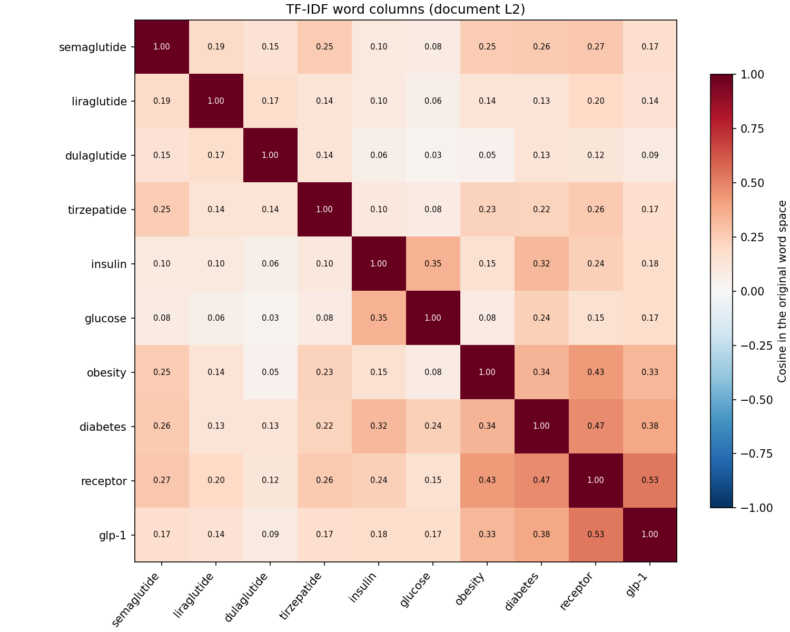
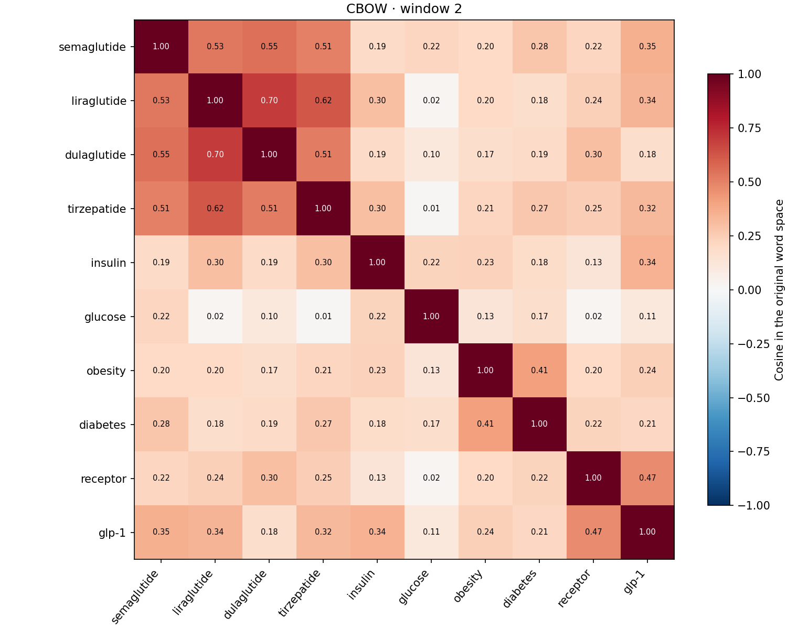
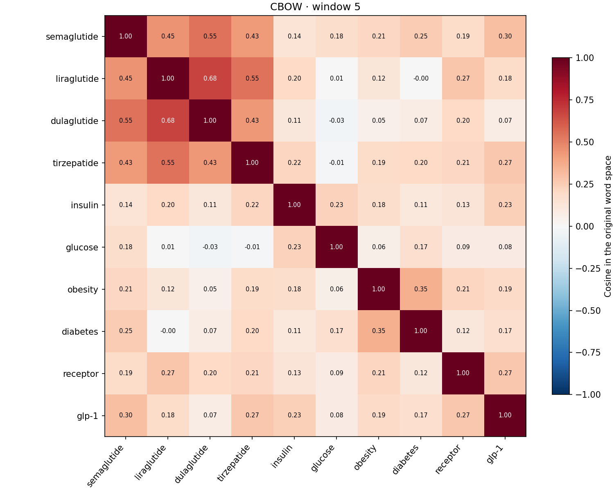
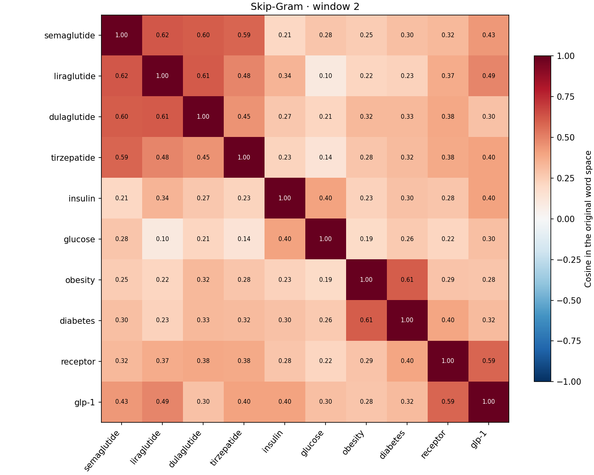
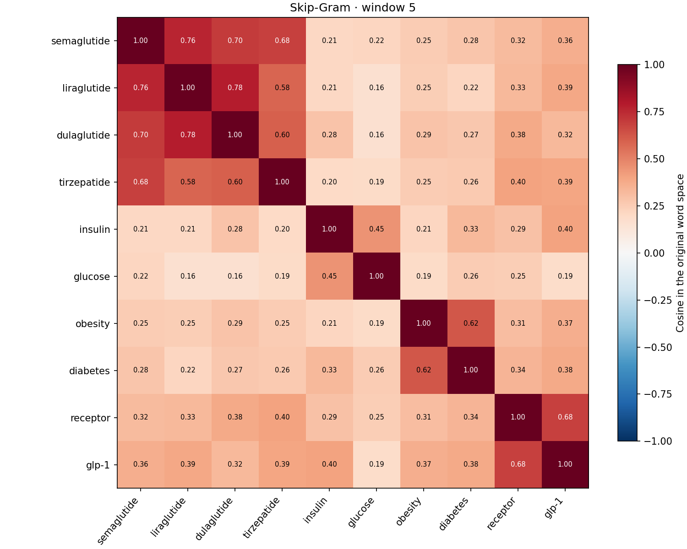
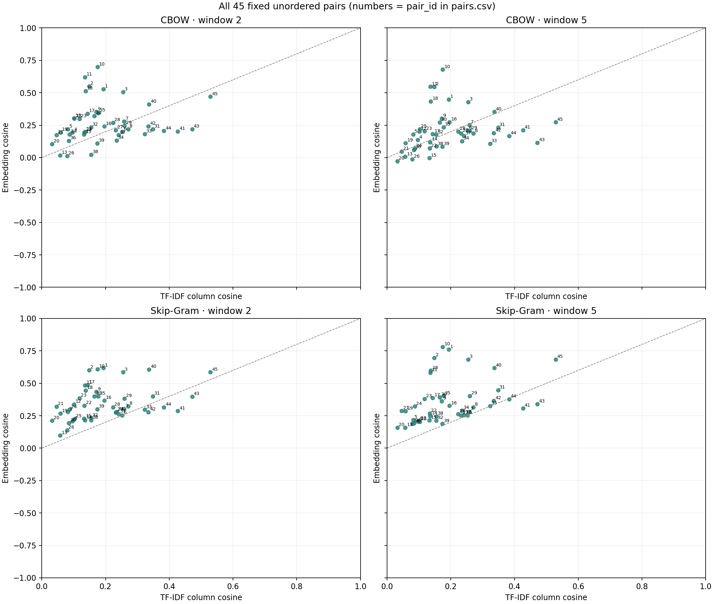
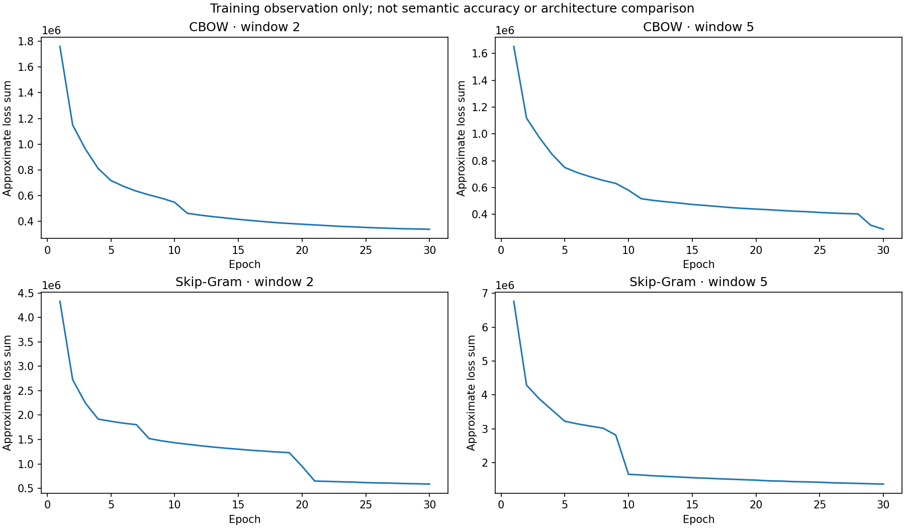

# HW3：同一批 3,000 篇的 Embedding 與 TF-IDF 詞彙關聯

本 run：`20261024-c-four-models`。四組模型各從新初始化，以同一批 **3,000 篇摘要、32,656 個非空句、539,158 tokens** 訓練；完整 C 詞彙 31,662，共同候選池 17,578。僅摘要正文，標題不進入任何向量。原有 RQ1–RQ5、檢索評估與人工標註另行保留。詞彙關聯統一採 C，舊 B 模型與成果依使用者要求移除。

## 1. 詞關係是否接近？

cbow_w2：ρ=0.3116、平均 Top-10 重疊=6.0%；cbow_w5：ρ=0.4387、平均 Top-10 重疊=5.0%；skipgram_w2：ρ=0.4095、平均 Top-10 重疊=8.0%；skipgram_w5：ρ=0.5159、平均 Top-10 重疊=21.0%。Spearman 描述固定詞對的相似度排序是否一致；Top-k 重疊描述整個共同候選池中的近鄰是否一致。兩者衡量一致程度，沒有語意 gold standard，不能解讀成正確率或勝負。

| model | k | mean_overlap | valid_terms | total_terms | rho | valid_pairs | status |
|---|---|---|---|---|---|---|---|
| cbow_w2 | 5 | 0.0200 | 10 | 10 | 0.3116 | 45 | ok |
| cbow_w5 | 5 | 0.0000 | 10 | 10 | 0.4387 | 45 | ok |
| skipgram_w2 | 5 | 0.1000 | 10 | 10 | 0.4095 | 45 | ok |
| skipgram_w5 | 5 | 0.2800 | 10 | 10 | 0.5159 | 45 | ok |
| cbow_w2 | 10 | 0.0600 | 10 | 10 | 0.3116 | 45 | ok |
| cbow_w5 | 10 | 0.0500 | 10 | 10 | 0.4387 | 45 | ok |
| skipgram_w2 | 10 | 0.0800 | 10 | 10 | 0.4095 | 45 | ok |
| skipgram_w5 | 10 | 0.2100 | 10 | 10 | 0.5159 | 45 | ok |
| cbow_w2 | 20 | 0.0700 | 10 | 10 | 0.3116 | 45 | ok |
| cbow_w5 | 20 | 0.0650 | 10 | 10 | 0.4387 | 45 | ok |
| skipgram_w2 | 20 | 0.0850 | 10 | 10 | 0.4095 | 45 | ok |
| skipgram_w5 | 20 | 0.1900 | 10 | 10 | 0.5159 | 45 | ok |

## 2. 詞群與實際例子

下表是事先固定詞群內的平均 cosine；不同表示的 cosine 分布及基線不同，不能僅以絕對分數較高判斷語意較好。

| group | tfidf | cbow_w2 | cbow_w5 | skipgram_w2 | skipgram_w5 |
|---|---|---|---|---|---|
| 四種藥物（6 對） | 0.1740 | 0.5691 | 0.5135 | 0.5577 | 0.6836 |
| insulin／glucose／diabetes（3 對） | 0.3041 | 0.1915 | 0.1688 | 0.3202 | 0.3425 |
| receptor／glp-1（1 對） | 0.5291 | 0.4698 | 0.2727 | 0.5855 | 0.6842 |

以下列出全部十詞的前 3 名，完整 Top-5／10／20 在 `neighbors.csv`；逐詞重疊及實際返回數在 `overlap.csv`，沒有事後只保留共同近鄰。

| term | tfidf | cbow_w2 | cbow_w5 | skipgram_w2 | skipgram_w5 |
|---|---|---|---|---|---|
| semaglutide | oral, agonist, weight | dulaglutide, metformin, liraglutide | dulaglutide, orforglipron, liraglutide | liraglutide, dulaglutide, tirzepatide | liraglutide, dulaglutide, tirzepatide |
| liraglutide | receptor, liraglutide-treated, semaglutide | dulaglutide, exenatide, tirzepatide | dulaglutide, exenatide, lixisenatide | semaglutide, dulaglutide, exenatide | dulaglutide, semaglutide, exenatide |
| dulaglutide | surpass-cvot, 39.45, paced | liraglutide, lixisenatide, empagliflozin | exenatide, liraglutide, lixisenatide | lixisenatide, non-eligible, macupatide | liraglutide, exenatide, semaglutide |
| tirzepatide | insulinotropic, glucose-dependent, polypeptide | liraglutide, dulaglutide, semaglutide | liraglutide, glp-1ras, dulaglutide | semaglutide, submaximal, pemvidutide | semaglutide, dulaglutide, liraglutide |
| insulin | resistance, glucose, diabetes | erythropoietin, u100, anabolic | erythropoietin, difficile, progesterone | resistance, matsuda, basal | resistance, glucotoxicity, glargine |
| glucose | tolerance, insulin, fasting | mixed-meal, urea, glycemia | glycemia, pressure, triglyceride-rich | 7-point, ogtt, 2-hour | postprandial, tolerance, fasting |
| obesity | weight, glucagon-like, receptor | masld, t1d, aud | masld, obese, obesity-related | tdt-induced, eot2d, pws | overweight, tdt-induced, diabetes |
| diabetes | type, 2, glucagon-like | dm, t2d, 2 | t2dm, t2d, dm | orc, youth-onset, mellitus | type, mellitus, 2 |
| receptor | agonists, glucagon-like, peptide-1 | receptor-β, gcgr, receptors | multi-receptor, thr-β, dual-receptor | agonists, 1-receptor, dual-acting | glucagon-like, peptide-1, agonists |
| glp-1 | ras, ra, receptor | glp1, gip, peptide-1 | glp1, incretin, srglp-1 | gip-glp-1, dual-acting, antecedent | glucagon-like, ras, peptide-1 |

- **CBOW · window 2**：差距最大詞對 liraglutide／dulaglutide，TF-IDF=0.1746、Embedding=0.6985，共同出現於 58 篇；差距最小詞對 tirzepatide／receptor，分別為 0.2595、0.2474。這是完整 45 對的描述統計，數值接近本身不等於語意正確。
- **CBOW · window 5**：差距最大詞對 liraglutide／dulaglutide，TF-IDF=0.1746、Embedding=0.6786，共同出現於 58 篇；差距最小詞對 dulaglutide／obesity，分別為 0.0459、0.0475。這是完整 45 對的描述統計，數值接近本身不等於語意正確。
- **Skip-Gram · window 2**：差距最大詞對 semaglutide／dulaglutide，TF-IDF=0.1482、Embedding=0.6020，共同出現於 74 篇；差距最小詞對 semaglutide／obesity，分別為 0.2522、0.2532。這是完整 45 對的描述統計，數值接近本身不等於語意正確。
- **Skip-Gram · window 5**：差距最大詞對 liraglutide／dulaglutide，TF-IDF=0.1746、Embedding=0.7815，共同出現於 58 篇；差距最小詞對 semaglutide／obesity，分別為 0.2522、0.2530。這是完整 45 對的描述統計，數值接近本身不等於語意正確。

## 3. CBOW／Skip-Gram 與 window 2／5

CBOW 平均局部上下文來預測中心詞，Skip-Gram 由中心詞預測局部上下文；window 是最大句內半徑，`shrink_windows=True` 使實際窗口隨機縮小。上方摘要保留四組全部結果，可直接比較同架構兩個 window、同 window 兩個架構的一致程度。這是固定 seed=42 的單次觀察；不能據此宣稱某架構或窗口普遍最佳。loss 僅供訓練觀察；不同架構的樣本數與累積誤差不同，不能以 loss 當成語意準確率或模型優劣證據。

## 4. 頻率、文件共現與局部上下文

TF-IDF 詞欄向量描述兩詞在整批文件的分布是否相似；僅同篇出現仍不足以保證高 cosine，還受各文件詞頻及整篇文件 norm 影響。Word2Vec 只看同句局部 context；兩詞可不常同篇直接共現，卻因出現在相似的局部上下文而接近。反之，同篇討論的疾病、藥物和試驗用語未必在局部 context 互換。高 CF／DF 通常提供較多訓練或分布資訊；固定停用詞表中的詞已在 C 前處理移除，沒有進入 TF-IDF、訓練序列、模型詞表或候選池，並非顯示階段隱藏。

| term | cf | df | tfidf | cbow_w2 | cbow_w5 | skipgram_w2 | skipgram_w5 | in_candidate_pool |
|---|---|---|---|---|---|---|---|---|
| semaglutide | 2107 | 708 | ok | ok | ok | ok | ok | True |
| liraglutide | 539 | 244 | ok | ok | ok | ok | ok | True |
| dulaglutide | 203 | 100 | ok | ok | ok | ok | ok | True |
| tirzepatide | 1264 | 431 | ok | ok | ok | ok | ok | True |
| insulin | 1249 | 595 | ok | ok | ok | ok | ok | True |
| glucose | 945 | 445 | ok | ok | ok | ok | ok | True |
| obesity | 2830 | 1307 | ok | ok | ok | ok | ok | True |
| diabetes | 2514 | 1534 | ok | ok | ok | ok | ok | True |
| receptor | 3530 | 2354 | ok | ok | ok | ok | ok | True |
| glp-1 | 5493 | 1783 | ok | ok | ok | ok | ok | True |

`pairs.csv` 的共同出現文件數以相同 3,000 篇、C 詞形計算。低頻詞受 min_count=2 影響，CF=1 會被 Word2Vec 排除；零 IDF 詞會產生 TF-IDF 零欄。狀態逐詞列出，缺詞沒有隨機替代。

## 5. 方法、順序及數學界線

文件以 PMID **字串升冪**排序（沿用 HW2 訓練規則），每篇保留原摘要區塊、句子與剩餘 token 順序；`document_order.json` 和 `sentences.jsonl` 可逐筆查核。每篇「逐句展平 tokens」與整個摘要區塊直接 C 前處理完全一致，並核對與檢索引擎 C 相同。沿用 `english-rules-v1` 句界，context 不跨文件、摘要區塊或偵測句界；縮寫、URL、DOI、email、小數有保護，規則式句界仍可能誤判。C 移除固定停用詞，不 stemming、不展開搜尋複合詞；全為停用詞的句子略過，window 以留下來的詞計算，不能視為仍採原始位置距離。

停用詞表：`resources/stopwords.json`，版本 `hw2-function-words-v1`，共 132 詞；SHA256：`d907482b2aabc0443ae05c95e0c9685ef6f8ff8789370a34c004a498d1abc406`。此表刻意保留 no、not、without 等否定詞。未列於表中的一般詞、數字或縮寫仍可能出現，去停用詞不保證近鄰具有醫學語意。

完整詞彙建立 A[d,t]=TF(d,t)×log10(N/DF(t))，N=3,000。先以**完整詞彙空間**計算每文件列 L2 norm，再將各列除以該 norm；零列保持零。取詞欄 u(t)（3,000 維）計算詞間 cosine。norm 不因畫面選詞或共同候選池改變。Embedding 用原始 100 維詞向量 cosine，沒有降維取代計算，也不跨空間相減或互算 cosine。

若省略文件列 L2，正 IDF 是每個詞欄的固定倍數，所以 cosine(c·u,d·v)=cosine(u,v)，IDF 會抵消（零 IDF／零欄不適用）。本方法保留的 IDF 影響，是 IDF 改變完整文件 norm 後對各文件座標的**間接**影響，不能籠統說 IDF 直接改變所有詞間 cosine。小型手算及 IDF 抵消測試見測試檔。

- 候選池：四模型詞彙與 TF-IDF 非零欄的交集，字串排序保存；所有方法共用 min_count=2 所得門檻，沒有額外顯示篩選。
- 近鄰：排除自身，所有方法只返回 cosine>0；零分、負分不補入 Top-k。不足 k 顯示實際返回數。**詞對、熱圖、散點保留所有負 cosine**，沒有截零。
- 同分：cosine 取 12 位小數後降冪，再按詞典序；CSV 保存原始分數。
- 重疊：交集數／請求 k（5／10／20），即使返回不足 k 仍固定分母；anchor 缺失或零向量為 NA，摘要明列實際有效分析詞數。
- 固定 45 對：十詞依固定順序取不重複組合，排除對角線。Spearman 使用相同順序、共同有限值、ties 平均名次；少於 2 對或常數陣列為 NA。不報統計顯著，因詞對共享詞彙且不是獨立樣本。

## 6. 完整 45 詞對

| pair_id | left | right | cooccurring_documents | tfidf | cbow_w2 | cbow_w5 | skipgram_w2 | skipgram_w5 |
|---|---|---|---|---|---|---|---|---|
| 1 | semaglutide | liraglutide | 155 | 0.1934 | 0.5274 | 0.4480 | 0.6181 | 0.7596 |
| 2 | semaglutide | dulaglutide | 74 | 0.1482 | 0.5509 | 0.5457 | 0.6020 | 0.6972 |
| 3 | semaglutide | tirzepatide | 229 | 0.2549 | 0.5053 | 0.4284 | 0.5855 | 0.6831 |
| 4 | semaglutide | insulin | 98 | 0.0963 | 0.1949 | 0.1359 | 0.2079 | 0.2050 |
| 5 | semaglutide | glucose | 81 | 0.0816 | 0.2185 | 0.1792 | 0.2799 | 0.2184 |
| 6 | semaglutide | obesity | 365 | 0.2522 | 0.1986 | 0.2084 | 0.2532 | 0.2530 |
| 7 | semaglutide | diabetes | 397 | 0.2581 | 0.2790 | 0.2514 | 0.3038 | 0.2796 |
| 8 | semaglutide | receptor | 584 | 0.2710 | 0.2184 | 0.1853 | 0.3230 | 0.3152 |
| 9 | semaglutide | glp-1 | 392 | 0.1708 | 0.3525 | 0.3014 | 0.4335 | 0.3635 |
| 10 | liraglutide | dulaglutide | 58 | 0.1746 | 0.6985 | 0.6786 | 0.6096 | 0.7815 |
| 11 | liraglutide | tirzepatide | 85 | 0.1354 | 0.6201 | 0.5465 | 0.4849 | 0.5821 |
| 12 | liraglutide | insulin | 46 | 0.1012 | 0.3025 | 0.2023 | 0.3371 | 0.2076 |
| 13 | liraglutide | glucose | 28 | 0.0572 | 0.0168 | 0.0060 | 0.0977 | 0.1581 |
| 14 | liraglutide | obesity | 125 | 0.1352 | 0.1982 | 0.1195 | 0.2155 | 0.2487 |
| 15 | liraglutide | diabetes | 123 | 0.1328 | 0.1785 | -0.0038 | 0.2270 | 0.2155 |
| 16 | liraglutide | receptor | 216 | 0.1959 | 0.2402 | 0.2741 | 0.3673 | 0.3266 |
| 17 | liraglutide | glp-1 | 150 | 0.1434 | 0.3387 | 0.1822 | 0.4863 | 0.3884 |
| 18 | dulaglutide | tirzepatide | 45 | 0.1373 | 0.5125 | 0.4337 | 0.4457 | 0.5982 |
| 19 | dulaglutide | insulin | 18 | 0.0580 | 0.1946 | 0.1120 | 0.2665 | 0.2846 |
| 20 | dulaglutide | glucose | 10 | 0.0320 | 0.1042 | -0.0271 | 0.2117 | 0.1587 |
| 21 | dulaglutide | obesity | 39 | 0.0459 | 0.1749 | 0.0475 | 0.3212 | 0.2876 |
| 22 | dulaglutide | diabetes | 77 | 0.1333 | 0.1936 | 0.0710 | 0.3270 | 0.2689 |
| 23 | dulaglutide | receptor | 90 | 0.1178 | 0.2998 | 0.2028 | 0.3845 | 0.3802 |
| 24 | dulaglutide | glp-1 | 57 | 0.0867 | 0.1792 | 0.0706 | 0.2968 | 0.3218 |
| 25 | tirzepatide | insulin | 72 | 0.1021 | 0.3002 | 0.2184 | 0.2254 | 0.2025 |
| 26 | tirzepatide | glucose | 45 | 0.0793 | 0.0131 | -0.0122 | 0.1387 | 0.1887 |
| 27 | tirzepatide | obesity | 258 | 0.2321 | 0.2116 | 0.1865 | 0.2755 | 0.2516 |
| 28 | tirzepatide | diabetes | 229 | 0.2234 | 0.2684 | 0.2012 | 0.3157 | 0.2635 |
| 29 | tirzepatide | receptor | 359 | 0.2595 | 0.2474 | 0.2062 | 0.3817 | 0.4016 |
| 30 | tirzepatide | glp-1 | 279 | 0.1653 | 0.3219 | 0.2709 | 0.4001 | 0.3919 |
| 31 | insulin | glucose | 233 | 0.3483 | 0.2198 | 0.2316 | 0.4007 | 0.4464 |
| 32 | insulin | obesity | 236 | 0.1544 | 0.2343 | 0.1758 | 0.2336 | 0.2141 |
| 33 | insulin | diabetes | 379 | 0.3230 | 0.1816 | 0.1070 | 0.2968 | 0.3251 |
| 34 | insulin | receptor | 430 | 0.2351 | 0.1326 | 0.1273 | 0.2799 | 0.2899 |
| 35 | insulin | glp-1 | 371 | 0.1769 | 0.3443 | 0.2346 | 0.3998 | 0.4036 |
| 36 | glucose | obesity | 155 | 0.0845 | 0.1305 | 0.0605 | 0.1928 | 0.1908 |
| 37 | glucose | diabetes | 275 | 0.2410 | 0.1731 | 0.1678 | 0.2631 | 0.2561 |
| 38 | glucose | receptor | 300 | 0.1547 | 0.0224 | 0.0858 | 0.2159 | 0.2462 |
| 39 | glucose | glp-1 | 298 | 0.1738 | 0.1092 | 0.0846 | 0.3009 | 0.1875 |
| 40 | obesity | diabetes | 776 | 0.3365 | 0.4111 | 0.3525 | 0.6060 | 0.6179 |
| 41 | obesity | receptor | 1072 | 0.4266 | 0.2014 | 0.2123 | 0.2868 | 0.3078 |
| 42 | obesity | glp-1 | 779 | 0.3347 | 0.2421 | 0.1892 | 0.2774 | 0.3660 |
| 43 | diabetes | receptor | 1293 | 0.4718 | 0.2199 | 0.1155 | 0.3972 | 0.3400 |
| 44 | diabetes | glp-1 | 895 | 0.3831 | 0.2059 | 0.1674 | 0.3155 | 0.3780 |
| 45 | receptor | glp-1 | 1433 | 0.5291 | 0.4698 | 0.2727 | 0.5855 | 0.6842 |

## 7. 圖表

五張熱圖使用完全相同十詞、順序與 [-1,1] 色階，保留負值與 NA。原空間 cosine 決定所有分數。











## 8. 限制及重現

這批 GLP-1 主題摘要不是隨機樣本，保留原 1,000 篇後擴充；主題偏差可能使常同篇出現的藥物、疾病、機制詞在 TF-IDF 接近。低頻詞向量與小樣本共現不穩定；只有一次 seed，無法估計重訓變異、一般化或統計顯著。句界規則可能誤判縮寫。新舊 1,000／3,000 篇模型的版本、順序及環境不同，不能只憑新舊差異歸因於增加語料。

正式檢索與評估沒有呼叫這個模組，也沒有使用這頁 session_state。原始 queries.json、人工標註與歷史結果均不回寫。

訓練（另開全新 run，不覆寫本次）：
```powershell
.\.venv\Scripts\python.exe -B -X utf8 -m ir_hw3.embedding_training
```
離線驗證：
```powershell
.\.venv\Scripts\python.exe -B -X utf8 -m ir_hw3.association_validation --run reports/word_association/runs/20261024-c-four-models
```

每模型 `models/<name>/metadata.json` 保存全部共同參數、額外 Gensim 預設、初始化向量指紋、每 epoch loss、時間、實際規模、語料／tokenizer／句界／程式指紋、版本與模型／向量 SHA256；`sources/` 凍結訓練程式。所有檔案指紋列於 manifest，成功離線重載後才標 complete；Streamlit 只載入已完成檔案，rerun 不訓練。

Corpus SHA256：`1166fc12efdabe5e9713e816d47e244b0b51ab19d7ba677f602d26c722f0f4c7`。實際版本：`{'python': '3.12.14', 'platform': 'Windows-11-10.0.26200-SP0', 'gensim': '4.4.0', 'numpy': '2.5.4', 'scipy': '1.18.1', 'regex': '2026.9.29', 'matplotlib': '3.10.8', 'streamlit': '1.66.0'}`。
